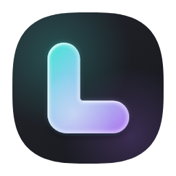
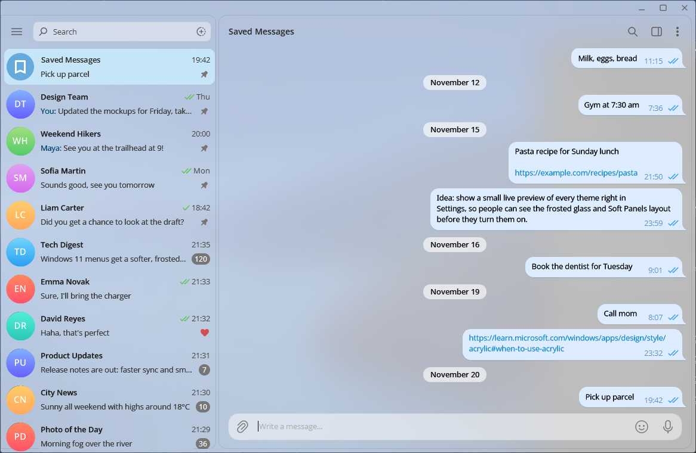
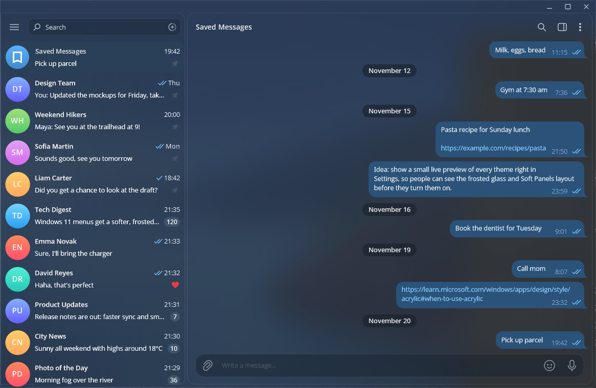

  

<h1 align="center">Lumigram</h1>

  A Telegram app for Windows 11, with a softer, lighter look. 
  Same chats, same account, same Telegram. It just looks at home on Windows 11.

  <a href="https://github.com/KakunArtem/Lumigram/releases"><b>Download</b></a> ·
  <a href="#install-it">Install</a> ·
  <a href="#questions">Questions</a> ·
  <a href="https://github.com/KakunArtem/Lumigram/issues">Report a problem</a>

  

> [!NOTE]
> Lumigram is an **unofficial** app. It is built on the open source code of
> [Telegram Desktop](https://github.com/telegramdesktop/tdesktop) but is not made
> or endorsed by Telegram. It talks to the same Telegram servers, so your chats
> and contacts work exactly as they do in any other Telegram app.

## How it looks

Lumigram works with every Telegram theme, light or dark, including the
custom themes from Telegram's theme catalog. It can also follow Windows: set
**Settings → Chat Settings → Auto-night mode** to **System**, and Lumigram
switches between light and dark whenever Windows does.

### Light

Bright and airy. The frosted glass lets your desktop show through as a soft
blue-gray haze. The chat list and the open chat each sit on their own
rounded panel, and your messages are pale blue bubbles with dark text.
Shown here with a blue custom theme from Telegram's theme catalog.

### Dark

Deep blue-gray glass that's easy on the eyes at night. Messages are blue
bubbles with light text, while links, read ticks and unread counters keep
their accent colors so they still stand out. Shown here with Telegram's
built-in **Tinted** night theme.

Screenshots taken on Windows 11. The chats, names and messages shown are
made up. The frosted background takes its colors from whatever is behind the
window, so yours will look a little different.

## Features

Everything you know from Telegram Desktop is here: chats, groups, channels,
calls, stickers, folders and all your cloud history. On top of that, Lumigram
gives it a Windows 11 look.

### Frosted glass windows

The main window uses Windows 11's frosted glass, called Acrylic. Your
wallpaper and the windows behind Lumigram show through softly, blurred and
tinted, so the app blends into your desktop instead of sitting on it like a
solid block. The chat area gets a lighter frosted layer too, so messages stay
easy to read.

### Frosted menus

Right-click menus and other pop-up menus get the same frosted glass and
appear instantly, much like the Windows 11 menus in File Explorer.

### Soft Panels layout

Settings, the main menu, and the share and forward windows are grouped into
rounded cards with space between them, instead of long flat lists with lines.
Related options sit together on one card, so screens are easier to scan.

### Rounded chat list and header

Folder tabs above the chat list are pills, the chat header sits on its own
soft bar, and the message bar at the bottom is a rounded field. Unread
counters for muted chats are toned down so the chats you care about stand
out.

### Share and forward without the clutter

Sharing or forwarding a message opens a cleaner window: a rounded list of
chats, a search field that blends in, and a comment field with the send
button built into it. In paid chats the button also shows the price in Stars.

### Rounded notifications

New message pop-ups in the corner of the screen are rounded cards that match
the rest of the app. You can pick which corner they appear in, and Lumigram
shows you a preview.

### Quieter scroll bars

Scroll bars stay thin and out of the way, then grow when you point at them so
they're easy to grab.

### Always current

Lumigram follows every Telegram Desktop release. New Telegram features
arrive here too, usually within a week.

### Your choice

The frosted glass and the Soft Panels layout can each be turned off in
**Settings → Advanced** (see [Change the look](#change-the-look)).

## Install it

You need **Windows 11, 64-bit**. Windows 10 may work, but the see-through
effects need Windows 11, and Windows 10 isn't tested.

1. Open the [Releases page](https://github.com/KakunArtem/Lumigram/releases)
   and download the newest `Lumigram-Setup-x64-….exe`.
2. Run it. Windows may show **"Windows protected your PC"** because the
   installer isn't signed yet. Click **More info**, then **Run anyway**.
3. Follow the setup steps. Lumigram installs for your Windows user only, so it
   doesn't ask for administrator rights.
4. Open Lumigram and sign in with your Telegram account. You can scan the QR
   code with Telegram on your phone (**Settings → Devices → Link Desktop
   Device**), or sign in with your phone number.

Already using Telegram Desktop? You can keep it. Lumigram is a separate app
with its own settings, so both can run side by side. Each one shows up as its
own device in **Settings → Devices** on your phone.

## Change the look

Open **Settings → Advanced** and look for these switches:

| Switch | What it does |
| --- | --- |
| Use window transparency | Frosted glass behind the main window |
| Use Soft Panels layout | Rounded cards in settings, menus and dialogs |
| Use transparency in menus | Frosted glass behind right-click and other menus |

Want new message pop-ups to look like Windows' own? Turn on **Use Windows
notifications** in **Settings → Notifications**.

## Update or remove it

- **Updating:** Lumigram doesn't update itself yet. When a new version appears
  on the [Releases page](https://github.com/KakunArtem/Lumigram/releases),
  download it and install it over the old one. You stay signed in and keep
  your settings.
- **Removing:** go to **Windows Settings → Apps → Installed apps**, find
  **Lumigram** and choose **Uninstall**. Your chats stay safe in your Telegram
  account.

## Questions

**Is my data safe?**
Lumigram uses the same Telegram servers and the same encryption as the
official apps. Messages go straight between your PC and Telegram. All of the
code is public in this repository, so anyone can check what it does.

**Do I need a new Telegram account?**
No. Sign in with the account you already have.

**Something looks wrong or doesn't work.**
Please [open an issue](https://github.com/KakunArtem/Lumigram/issues) and
add a screenshot if you can. If the problem is with the look, try turning the
switch from [Change the look](#change-the-look) off and on again, and say in
the issue whether that changed anything.

## For developers

Lumigram is Telegram Desktop (C++ and Qt 6) plus a set of Windows 11 changes.
The UI changes live partly in this repository and partly in our fork of
[lib_ui](https://github.com/KakunArtem/lib_ui) (branch `soft-panels`), which
is included as the `Telegram/lib_ui` submodule.

- **Build it:** follow [Building on Windows](docs/building-win.md). The main
  branch is `dev`. Like any Telegram app, you need your own
  [API credentials](docs/api_credentials.md).
- **Design notes:** the redesign plans and decisions are in
  [docs/ui-modernization](docs/ui-modernization/architecture.md).
- **Staying current:** new Telegram Desktop releases are merged into `dev`
  through `sync/<version>` pull requests.

## Code signing policy

Releases are built from this repository on GitHub's own servers. Signing goes
through SignPath Foundation: free code signing provided by
[SignPath.io](https://about.signpath.io), certificate by
[SignPath Foundation](https://signpath.org). The application is pending, so
releases are unsigned for now. Who builds, reviews and approves releases, and
what Lumigram sends over the network, is in the
[code signing policy](CODE_SIGNING_POLICY.md).

## License and credits

Lumigram is free software under the
[GNU General Public License v3](LICENSE) with the OpenSSL exception, the same
license as Telegram Desktop (see [LEGAL](LEGAL)).

The app itself is the work of the
[Telegram Desktop](https://github.com/telegramdesktop/tdesktop) authors and
the libraries below. Telegram is a trademark of Telegram FZ-LLC; Lumigram is
not affiliated with it.

Third-party libraries and their licenses

* Qt 6 ([LGPL](http://doc.qt.io/qt-6/lgpl.html)), slightly patched
* OpenSSL 3.2.1 ([Apache License 2.0](https://openssl-library.org/source/license/apache-license-2.0.txt))
* WebRTC ([New BSD License](https://github.com/desktop-app/tg_owt/blob/master/LICENSE))
* zlib ([zlib License](http://www.zlib.net/zlib_license.html))
* LZMA SDK 9.20 ([public domain](http://www.7-zip.org/sdk.html))
* liblzma ([public domain](http://tukaani.org/xz/))
* Google Breakpad ([License](https://chromium.googlesource.com/breakpad/breakpad/+/master/LICENSE))
* Google Crashpad ([Apache License 2.0](https://chromium.googlesource.com/crashpad/crashpad/+/master/LICENSE))
* GYP ([BSD License](https://github.com/bnoordhuis/gyp/blob/master/LICENSE))
* Ninja ([Apache License 2.0](https://github.com/ninja-build/ninja/blob/master/COPYING))
* OpenAL Soft ([LGPL](https://github.com/kcat/openal-soft/blob/master/COPYING))
* Opus codec ([BSD License](http://www.opus-codec.org/license/))
* FFmpeg ([LGPL](https://www.ffmpeg.org/legal.html))
* Guideline Support Library ([MIT License](https://github.com/Microsoft/GSL/blob/master/LICENSE))
* Range-v3 ([Boost License](https://github.com/ericniebler/range-v3/blob/master/LICENSE.txt))
* Open Sans font ([Apache License 2.0](http://www.apache.org/licenses/LICENSE-2.0.html))
* Vazirmatn font ([SIL Open Font License 1.1](https://github.com/rastikerdar/vazirmatn/blob/master/OFL.txt))
* Emoji alpha codes ([MIT License](https://github.com/emojione/emojione/blob/master/extras/alpha-codes/LICENSE.md))
* xxHash ([BSD License](https://github.com/Cyan4973/xxHash/blob/dev/LICENSE))
* QR Code generator ([MIT License](https://github.com/nayuki/QR-Code-generator#license))
* CMake ([New BSD License](https://github.com/Kitware/CMake/blob/master/Copyright.txt))
* Hunspell ([LGPL](https://github.com/hunspell/hunspell/blob/master/COPYING.LESSER))
* zxcvbn-c ([MIT License](https://github.com/tsyrogit/zxcvbn-c/blob/master/LICENSE.txt))
* twidget ([BSD 3-Clause License](https://github.com/TelegramMessenger/twidget/blob/main/LICENSE))
* litehtml ([BSD 3-Clause License](https://github.com/litehtml/litehtml/blob/master/LICENSE))
* Gumbo ([Apache License 2.0](https://github.com/google/gumbo-parser/blob/master/COPYING))
* QuickJS-ng ([MIT License](https://github.com/quickjs-ng/quickjs/blob/master/LICENSE))
* FrequencyWords by Hermit Dave ([Creative Commons Attribution-ShareAlike 4.0](https://creativecommons.org/licenses/by-sa/4.0/))

